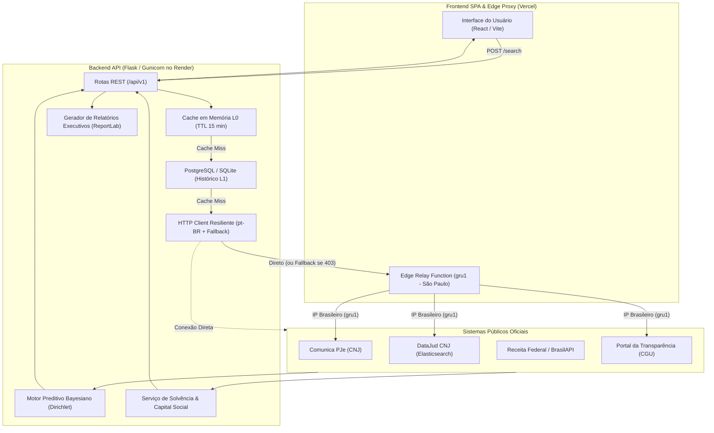

# RadarJus: Monitor Preditivo de Risco Trabalhista e Idoneidade de Terceiros (Súmula 331 TST)

[-success?style=flat&logo=pytest&logoColor=white)](https://github.com/radarjud/radarjud/actions)
[-brightgreen?style=flat&logo=ruff&logoColor=black)](https://github.com/radarjud/radarjud/actions)
[](https://github.com/radarjud/radarjud)
[](https://python.org)
[](https://react.dev)
[](https://www.tst.jus.br)

Plataforma inteligente de auditoria e conformidade contínua para contratação de prestadores de serviços, terceirizados e fornecedores. Cruza metadados abertos do Poder Judiciário (CNJ) com bases governamentais da Receita Federal, CGU e PGFN para antecipar desfechos processuais e calcular o risco de calote subsidiário ao tomador de serviços.

---

## 🛠️ Stack Tecnológica & Ferramentas

| Domínio | Tecnologias e Ferramentas |
|:---|:---|
| **Backend e Arquitetura** |       |
| **Modelagem Preditiva & Métricas** |     |
| **Mensageria & Integração Governamental** | -1B365D?style=flat&logo=googleearth&logoColor=white) -005571?style=flat&logo=elasticsearch&logoColor=white)  -0B6623?style=flat&logo=open-access&logoColor=white)  |
| **Web Frontend** |      |
| **Bancos de Dados & Armazenamento** |   -FF6F00?style=flat&logo=redis&logoColor=white) |
| **DevOps, Garantia de Qualidade & Nuvem** |  -000000?style=flat&logo=vercel&logoColor=white)   -0A9EDC?style=flat&logo=pytest&logoColor=white)   |

---

## 🏛️ 1. O Problema e a Solução

### O Risco Jurídico da Súmula 331 do TST
Ao terceirizar atividades, a legislação brasileira impõe ao tomador de serviços a **responsabilidade subsidiária** pelas dívidas trabalhistas não honradas pela contratada (Súmula 331, itens IV e VI do TST). Se a empresa terceirizada sofrer condenações e não tiver capital social, saldo em conta ou patrimônio suficiente, o juiz do trabalho efetua a penhora eletrônica direta nas contas bancárias do **tomador dos serviços**.

### A Abordagem do RadarJus
O RadarJus realiza uma auditoria preditiva e cadastral em duas frentes complementares:

1. **Passivo Trabalhista Real nos Tribunais**: Mapeia o histórico processual, desfechos de sentenças (condenações, acordos, improcedências) e estima a probabilidade de êxito nos processos em aberto via **pura matemática preditiva bayesiana (sem alucinações de IA/LLM)**.
2. **Idoneidade Econômico-Financeira e Cadastral**: Verifica a saúde financeira da contratada (Capital Social, regularidade na Receita Federal, sanções da CGU, Dívida Ativa da União e ações de falência/recuperação judicial), calculando o **Risco Real de Calote Subsidiário**:

$$\text{Risco Real de Calote Subsidiário} = P(\text{Condenação}) \times P(\text{Insolvência})$$

> **Onde:**
> - $P(\text{Condenação})$: Probabilidade preditiva estimada pelo motor bayesiano Dirichlet-Multinomial para os processos em aberto da empresa.
> - $P(\text{Insolvência})$: Taxa atuarial calculada a partir do porte da empresa, Capital Social consolidado perante a RFB e registros em certidões negativas / recuperações judiciais.

---

## 🌐 2. Fontes Governamentais e APIs Públicas Integradas

| Fonte Governamental | Dados Extraídos | Propósito na Plataforma |
|:---|:---|:---|
| **Comunica PJe (CNJ)** | Publicações e intimações oficiais dos diários de justiça trabalhistas. | Descoberta do acervo de processos por Razão Social/CNPJ e extração do teor das decisões. |
| **DataJud (CNJ / Elasticsearch)** | Metadados TPU (Tabela Processual Unificada), níveis de sigilo e movimentos. | Classificação exata de assuntos (código TPU), detecção de perícias e desfechos de mérito. |
| **BrasilAPI / Receita Federal** | Situação cadastral, Capital Social, Quadro de Sócios (QSA) e e-mail. | Avaliação da solidez societária, triangulação de CNPJ e busca de logomarca corporativa. |
| **CGU Portal da Transparência** | Cadastros CEIS (Inidôneas), CNEP (Punidas) e CEPIM (Impedidas). | Identificação de proibições de licitar, fraudes e sanções administrativas ativas. |
| **PGFN Dados Abertos** | Dívida Ativa da União e FGTS. | Verificação de certidão negativa e inadimplência de FGTS ou multas trabalhistas do MTE. |

---

## 🛡️ 3. Arquitetura Tripla Anti-Geoblocking (Render + Vercel)

Quando o backend é hospedado em provedores de nuvem internacionais (ex: plano gratuito do Render nos EUA), os firewalls dos órgãos governamentais brasileiros (PJe, DataJud, CGU) bloqueiam os IPs externos com `HTTP 403 Forbidden` ou `Timeout`. 

O RadarJus implementa uma **Arquitetura Tripla Anti-Geoblocking 100% transparente para o usuário final**:

1. **Relay Serverless Edge na Vercel (`gru1`)**: Uma Serverless Edge Function (`frontend/api/cnj-proxy.js`) forçada no datacenter de Guarulhos/SP atua como ponte oficial de IP brasileiro com whitelist de domínios.
2. **Cliente HTTP Inteligente com Headers Brasileiros**: No backend Python (`app/utils/http_client.py`), todas as chamadas enviam cabeçalhos completos de navegador (`pt-BR`) e chaveiam automaticamente para o `CNJ_PROXY_URL` em caso de erro 403 ou timeout.
3. **Browser Edge Fetch Silencioso**: No frontend (`frontend/src/App.jsx`), uma rotina invisível pré-carrega as intimações via conexão local do próprio usuário (`client_prefetched_items`) e as envia ao backend caso a coleta direta nos EUA seja barrada.

---

## 📐 4. Inteligência Preditiva Bayesiana (Pura Matemática)

O motor de previsão (`BayesianRiskPredictor`) baseia-se em formulações estatísticas analíticas exatas da **Conjugação Dirichlet-Multinomial e Beta-Binomial**:

- **Distribuição Tripartida**: Separa formalmente as probabilidades de Vitória/Improcedência ($\theta_{\text{imp}}$), Acordo Judicial ($\theta_{\text{acordo}}$) e Condenação ($\theta_{\text{cond}}$).
- **Intervalo de Credibilidade de 90% (IC 90%)**: Derivado diretamente da distribuição acumulada da função Beta marginal ($F_{\text{Beta}}^{-1}$).
- **Regra Crítica de Previsão Zero**: Empresas sem condenações pretéritas registradas nos tribunais consultados **não recebem previsão de condenação** ($P_{\text{cond}} = 0.0$), respeitando a presunção legal de idoneidade.
- **Ranking de Motivos de Condenação**: Mapeia os assuntos onde a empresa foi historicamente condenada, utilizando esse percentual como ponderador empírico (*Empirical Bayes Leave-One-Subject-Out*) para calibrar processos abertos do mesmo tema.

---

## 🏗️ 5. Diagrama de Arquitetura do Sistema



---

## 🚀 6. Como Subir e Executar o Projeto Localmente

### Pré-requisitos
- **Python 3.11+** ou **3.12+** instalado.
- **Node.js 18+** e **npm** instalados.
- **PostgreSQL 14+** (ou SQLite para desenvolvimento local / Docker).

---

### Execução Local Rápida (Recomendada)

#### 1. Configurar e Ativar o Ambiente Virtual Python
Na raiz do projeto (`radarjud/`):
```bash
# Cria o ambiente virtual
python3 -m venv .venv

# Ativa o ambiente virtual no Linux/macOS:
source .venv/bin/activate

# Ou no Windows (PowerShell):
# .venv\Scripts\Activate.ps1

# Instala todas as dependências do backend
pip install -r requirements.txt
```

#### 2. Configurar Variáveis de Ambiente
Copie o arquivo de exemplo:
```bash
cp .env.example .env
```

#### 3. Executar os Testes Automatizados & Linter
Garanta que todos os módulos estão 100% íntegros:
```bash
# Executa a suíte completa de 101 testes
.venv/bin/pytest -v

# Valida sintaxe e contratos do código com Ruff
ruff check . --select=E9,F63,F7,F82
```
*(Todos os **101 testes automatizados** devem passar com 100% de sucesso em menos de 1 segundo).*

#### 4. Iniciar o Servidor Backend (Flask)
```bash
python run.py
```
*O backend estará rodando em `http://localhost:5000` (com endpoints em `/api/v1`).*

#### 5. Configurar e Iniciar o Frontend (React + Vite)
Abra outro terminal e acesse a pasta `frontend/`:
```bash
cd frontend

# Instala as dependências
npm install

# Inicia o servidor de desenvolvimento Vite
npm run dev
```
*O frontend estará disponível em `http://localhost:5173`.*

---

### Execução via Docker Compose

Caso prefira executar todos os serviços containerizados:
```bash
docker-compose up -d --build
```
- Frontend: `http://localhost:5173`
- Backend API: `http://localhost:5000`

---

## 📄 7. Exportação de Relatórios em PDF

A plataforma conta com um módulo nativo de exportação de **Relatórios Executivos em PDF** (`ReportLab` + motor vetorial puro):
- Resumo executivo cadastral e situação na Receita Federal.
- Panorama preditivo e matriz Dirichlet-Multinomial.
- Auditoria de Solvência e Risco de Calote Subsidiário (**Cenário A / Cenário B**).
- Tabela analítica completa dos desfechos processuais mapeados.

Rotas disponíveis:
- `GET /api/v1/history/<id>/summary.pdf`
- `POST /api/v1/report/pdf` (gera o PDF instantaneamente a partir dos dados em tela).

---

## 🛡️ Licença e Propriedade
Desenvolvido sob rigorosos padrões de conformidade jurídica para prevenção de riscos de terceirização sob a égide da **Súmula 331 do Tribunal Superior do Trabalho**.
