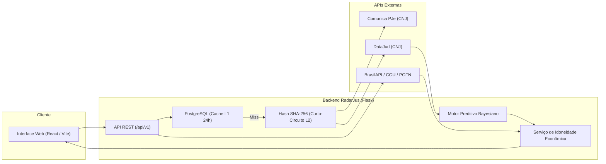

# RadarJus: Monitor Preditivo de Risco Trabalhista e Idoneidade de Terceiros (Súmula 331 TST)

Plataforma inteligente de auditoria e conformidade contínua para contratação de prestadores de serviços, terceirizados e fornecedores. Cruza metadados abertos do Poder Judiciário (CNJ) com bases governamentais da Receita Federal, CGU e PGFN para antecipar desfechos processuais e calcular o risco de calote subsidiário ao tomador de serviços.

---

## 🏛️ 1. O Problema e a Solução

### O Risco Jurídico da Súmula 331 do TST
Ao terceirizar atividades, a legislação brasileira impõe ao tomador de serviços a **responsabilidade subsidiária** pelas dívidas trabalhistas não honradas pela contratada (Súmula 331, itens IV e VI do TST). Se a empresa terceirizada sofrer condenações e não tiver capital social, saldo em conta ou patrimônio suficiente, o juiz do trabalho efetua a penhora eletrônica direta nas contas bancárias do **tomador dos serviços**.

### A Abordagem do RadarJus
O RadarJus realiza uma auditoria em duas frentes complementares:
1. **Passivo Trabalhista Real nos Tribunais**: Mapeia o histórico processual, desfechos de sentenças (condenações, acordos, improcedências) e estima a probabilidade de êxito nos processos em aberto via **pura matemática preditiva bayesiana (sem alucinações de IA/LLM)**.
2. **Idoneidade Econômico-Financeira e Cadastral**: Verifica a saúde financeira da contratada (Capital Social, regularidade na Receita Federal, sanções da CGU, Dívida Ativa da União e ações de falência/recuperação judicial), calculando o **Risco Real de Calote Subsidiário** ($P(\text{Condenação}) \times P(\text{Insolvência})$).

---

## 🌐 2. Fontes Governamentais e APIs Públicas Integradas

| Fonte Governamental | Dados Extraídos | Propósito na Plataforma |
|:---|:---|:---|
| **Comunica PJe (CNJ)** | Publicações e intimações oficiais dos diários de justiça trabalhistas. | Descoberta do acervo de processos por Razão Social/CNPJ e extração do teor das decisões. |
| **DataJud (CNJ / Elasticsearch)** | Metadados TPU (Tabela Processual Unificada), níveis de sigilo e movimentos. | Classificação exata de assuntos (código TPU), detecção de perícias e desfechos de mérito. |
| **BrasilAPI / Receita Federal** | Situação cadastral, Capital Social, Quadro de Sócios (QSA) e e-mail. | Avaliação da solidez societária, triangulação de CNPJ e busca de logomarca corporativa. |
| **CGU Portal da Transparência** | Cadastros CEIS (Inidôneas), CNEP (Punidas) e CEPIM (Impedidas). | Identificação de proibições de licitar, fraudes e sanções administrativas ativas. |
| **PGFN Dados Abertos** | Dívida Ativa da União e FGTS. | Verificação de certidão negativa e inadimplência de FGTS ou multas trabalhistas do MTE. |

---

## 📐 3. Inteligência Preditiva Bayesiana (Pura Matemática)

O motor de previsão (`BayesianRiskPredictor`) baseia-se em formulações estatísticas analíticas exatas da **Conjugação Dirichlet-Multinomial e Beta-Binomial**:

- **Distribuição Tripartida**: Separa formalmente as probabilidades de Vitória/Improcedência ($\theta_{\text{imp}}$), Acordo Judicial ($\theta_{\text{acordo}}$) e Condenação ($\theta_{\text{cond}}$).
- **Intervalo de Credibilidade de 90% (IC 90%)**: Derivado diretamente da distribuição acumulada da função Beta marginal ($F_{\text{Beta}}^{-1}$).
- **Regra Crítica de Previsão Zero**: Empresas sem condenações pretéritas registradas nos tribunais consultados **não recebem previsão de condenação** ($P_{\text{cond}} = 0.0$), respeitando a presunção legal de idoneidade.
- **Ranking de Motivos de Condenação**: Mapeia os assuntos onde a empresa foi historicamente condenada, utilizando esse percentual como ponderador empírico (*Empirical Bayes Leave-One-Subject-Out*) para calibrar processos abertos do mesmo tema.

---

## 🏗️ 4. Diagrama de Arquitetura



---

## 🚀 5. Como Subir e Executar o Projeto Localmente

### Pré-requisitos
- **Python 3.12+** instalado.
- **Node.js 18+** e **npm** instalados.
- **PostgreSQL 14+** (ou Docker / Docker Compose).

---

### Opção A: Execução Local Rápida (Recomendada para Desenvolvimento)

#### 1. Configurar e Ativar o Ambiente Virtual Python
Na raiz do projeto (`radarjud/`):
```bash
# Cria o ambiente virtual
python3 -m venv .venv

# Ativa o ambiente virtual no Linux/macOS:
source .venv/bin/activate

# Ou no Windows (PowerShell):
# .venv\Scripts\Activate.ps1

# Instala todas as dependências do backend
pip install -r requirements.txt
```

#### 2. Configurar Variáveis de Ambiente
Copie o arquivo de exemplo e configure sua chave DataJud (caso possua):
```bash
cp .env.example .env
```

#### 3. Executar os Testes Automatizados
Garanta que todos os módulos estão íntegros e validados:
```bash
.venv/bin/pytest tests
```
*(Todos os 39 testes unitários e de integração devem passar com 100% de sucesso).*

#### 4. Iniciar o Servidor Backend (Flask)
```bash
python run.py
```
*O backend estará rodando em `http://localhost:5000` (com endpoints em `/api/v1`).*

#### 5. Configurar e Iniciar o Frontend (React + Vite)
Abra um novo terminal e navegue até a pasta `frontend`:
```bash
cd frontend

# IMPORTANTE: Instala as dependências do Node.js (necessário para resolver o vite)
npm install

# Inicia o servidor de desenvolvimento
npm run dev
```
*O frontend estará disponível em `http://localhost:5173`.*

> **Dica para o erro `sh: 1: vite: not found`**:  
> Se esse erro ocorrer ao executar `npm run dev`, significa que a pasta `node_modules` não foi instalada ou os executáveis locais não estão no PATH. Basta rodar `npm install` dentro da pasta `frontend/` e rodar novamente `npm run dev`. O script de inicialização do projeto utiliza `npx vite --host 0.0.0.0` para máxima compatibilidade.

---

### Opção B: Execução Completa via Docker Compose

Caso prefira rodar toda a infraestrutura encapsulada (PostgreSQL + Backend + Frontend):
```bash
# Sobe o banco de dados e os serviços
docker-compose up -d --build
```
- Frontend: `http://localhost:5173`
- Backend: `http://localhost:5000`

---

## 🛡️ Licença e Propriedade
Desenvolvido sob padrões de conformidade jurídica para prevenção de riscos de terceirização sob a égide da **Súmula 331 do Tribunal Superior do Trabalho**.
